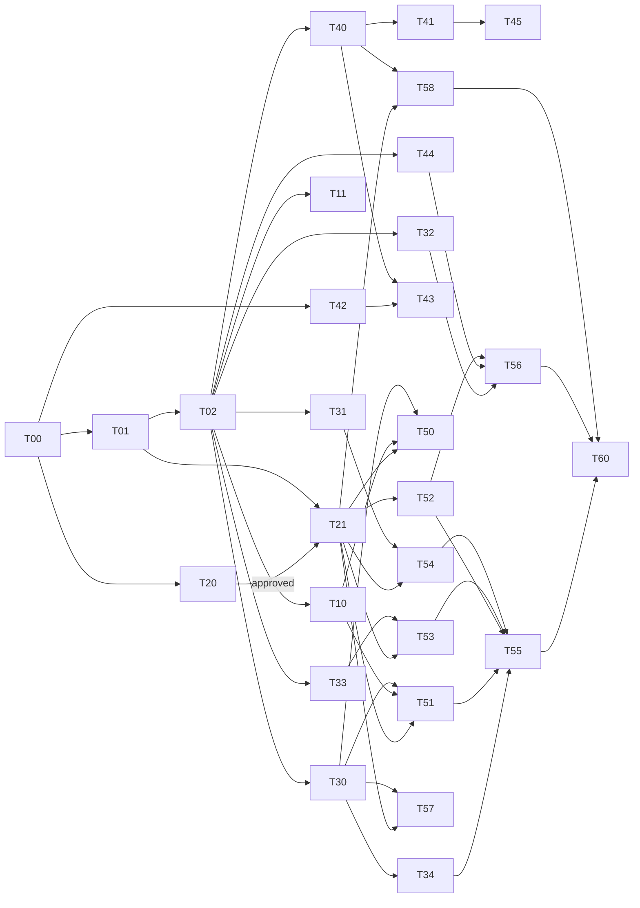

# Task tracker

How to use this file (full rules in [`CLAUDE.md`](../CLAUDE.md)):
- Pick a `todo` task whose `Depends on` tasks are all `done`. Claim it in your task's own PR by editing **only** the `Status:` / `Branch:` / `PR:` lines in that task's block.
- Status values: `todo` · `in-progress` · `in-review` · `blocked (<reason>)` · `done`.
- Each task's mutable lines are separated from every other task's by static lines, so parallel sessions don't conflict. **Don't add a status summary table.**
- New tasks are appended at the end of their lane with the next unused ID. Never renumber.
- Design reference: [`PLAN.md`](PLAN.md).

## Dependency graph (static)

**Critical path:** T00 → T01 → T02 → T30 → T34 → T55 → T60.
**Near-critical (human-gated):** T20 (design approval) → T21 → T52/T53/T54 → T55. Start T20 immediately.

**Concurrency waves:**

| Wave | Starts after | Tasks | Max sessions |
|---|---|---|---|
| 1 | T00 | T01, T20, T42 | 3 |
| 2 | T02 | T10, T11, T30, T31, T32, T33, T40, T44 | 8 (4–5 recommended) |
| 3 | T30 / T21 | T34, T57 | 2 (plus anything left from wave 2) |
| 4 | T21 + deps | T50, T51, T52, T53, T54, T41, T58 | 7 |
| 5 | | T55, T56, T43 | 3 |
| 6 | | T60 | 1 |

**Human dependencies:** T00 GitHub settings · T20 design approval. No API key is needed: audio starts on the browser's built-in voices (T40, T41).

---

## Phase 0 · Foundation (serial)

### T00 · Bootstrap repo & process
Lane: 0 · Approval: none · Size: S
Depends on: —
Unblocks: T01, T20, T42
Goal: `main` branch exists. CLAUDE.md, docs/PLAN.md, docs/TASKS.md, PR template, and CI (`changes` / `approval-gate` / `verify` / `e2e` / `ci-ok`) are in place.
Also: `.github/workflows/pages.yml` deploys to GitHub Pages on every non-docs merge to `main` (placeholder page until T01).
Done when: a docs-only PR runs only the gate jobs and `ci-ok` is green. The user has turned on the GitHub settings: Pages source = GitHub Actions, protect `main` (require PR + `ci-ok` check), allow auto-merge, squash merge, auto-delete head branches, and create the `needs-approval` label.

Status: done
Branch: ccr-3d9b833b-bc5ofy
PR: #1

### T01 · App scaffold
Lane: 0 · Approval: none · Size: M
Depends on: T00
Unblocks: T02, T21
Goal: Vite + React 19 + TS strict app, using pnpm (`packageManager` field set), ESLint + Prettier, Vitest + Testing Library, Playwright (phone viewport), and a `vite-plugin-pwa` stub. Folder skeleton from PLAN §E1. **GitHub Pages:** Vite `base: '/300TangTangles/'`, PWA `scope`/`start_url` under that base, and hash-based or base-aware routing so deep links work.
Done when: these package scripts exist and pass in CI: `lint`, `typecheck`, `test`, `validate:content` (may be a no-op until T02), `build`, `e2e`. There is one red→green component test and one Playwright smoke test of the app shell (run against `vite preview` with the Pages base path). After merge, the Pages deploy serves the app shell.

Status: done
Branch: ccr-ec62b64b-9ixhoz
PR: #3

### T02 · Core contracts
Lane: 0 · Approval: none · Size: M
Depends on: T01
Unblocks: T10, T11, T30, T31, T32, T33, T40, T44, T52
Goal: Zod poem schema (lines, chars Trad/Simp, readings zhuyin/pinyin/jyutping/tailo (tailo has two layers: `lit` 文讀 and `col` 白讀), units incl. compounds, translations, notes, meta) with inferred types. `src/core/types.ts`: UnitId, UnitStatus, LexiconEntry, Exercise (discriminated union), ExerciseResult, LineMastery {recognition, production, meaning, recitation}, EngineState, Rank, Settings. Signature `nextExercise(state): Exercise`. A test fixture poem. `validate:content` validates `content/poems/*.json`.
Done when: schema tests pass (valid fixture accepted, malformed fixtures rejected). Types are exported and documented.

Status: done
Branch: task/T02-core-contracts
PR: —

## Lane A · Content

### T10 · 靜夜思 content
Lane: A · Approval: none · Size: M
Depends on: T02
Unblocks: T50, T51
Goal: `content/poems/jingyesi.json`: standard school text (Trad + Simp), per-char zhuyin, pinyin, Jyutping, and Tâi-lô in both layers (文讀 and 白讀, checked against the MOE dictionary's [文]/[白] marks); compounds 明月 地上 舉頭 低頭 故鄉; per-char and per-line glosses; literal and poetic translations; a "what the poet feels" meaning prompt for each line; scholar's notes (床 debate, Song variant, rhyme, 平仄); distractor seeds (看, 山, 雪, 卿…).
Done when: `validate:content` passes. Readings are cross-checked against a dictionary and the sources are listed in the PR.

Status: done
Branch: task/T10-jingyesi
PR: #16

### T11 · Catalog scoring
Lane: A · Approval: none · Size: M
Depends on: T02
Unblocks: —
Goal: `scripts/score-poems.ts` computes familiarity from curriculum exposure, char frequency (mean + 25th percentile), and length, then assigns tiers and 1–5 ink drops. Source data files with their provenance. 3–5 stub catalog entries (metadata only), shown as "coming soon".
Done when: unit tests (red/green) cover the scoring formula and tier assignment, and the catalog index is generated.

Status: done
Branch: task/T11-catalog-scoring
PR: #15

## Lane B · Design & UI kit

### T20 · Design mock-ups
Lane: B · Approval: **required (design)** · Size: M
Depends on: T00
Unblocks: T21
Goal: Tang visual design. Pigment tokens for light (宣紙) and dark (lacquer + gold) themes; fonts (LXGW WenKai / Noto Serif TC); bopomofo-right and pinyin-top ruby; CharTile states (new / learning 1–4 / known); Tangle tiles with glyphs (〇△◇✕); seal; the fading-scroll states; phone mock-ups of Library, Reading, Session (Continue), Tangle, and Result. Publish as an artifact or static HTML in `design/`.
Done when: a human approves. The PR carries the `needs-approval` label.

Status: done
Branch: ccr-aa2835ff-f0gpn2
PR: #4

### T21 · Theme tokens & UI primitives
Lane: B · Approval: none · Size: M
Depends on: T01, T20
Unblocks: T50, T51, T52, T53, T54, T57, T58
Goal: CSS variable tokens from the approved T20 design; theme switching. Components `RubyChar` (zhuyin/pinyin/jyutping/tailo, off), `CharTile`, `ScrollFrame`, `Seal`, `Button`, `AudioButton` shell.
Done when: component tests cover every visual state and romanization mode. Playwright screenshots in both themes are attached to the PR.

Status: done
Branch: ccr-aa2835ff-f0gpn2
PR: #6

## Lane C · Domain logic (pure TS)

### T30 · Lexicon store
Lane: C · Approval: none · Size: M
Depends on: T02
Unblocks: T34, T50, T51, T57
Goal: global lexicon of unit statuses (new / learning 1–4 / known / ignored). `ts-fsrs` scheduling with mapping from review results to learning level; manual override; IndexedDB persistence (`idb-keyval`); versioned export/import JSON.
Done when: tests cover status transitions, cross-poem sharing, persistence round-trip (fake-indexeddb), and import validation.

Status: done
Branch: task/T30-lexicon-store
PR: #13

### T31 · Tangle feedback algorithm
Lane: C · Approval: none · Size: S
Depends on: T02
Unblocks: T54
Goal: count-aware 4-state feedback (correct / in-line / other-line / absent) for a row guess against the poem; bank-tile color aggregation; attempt budget (6 per line), with an exhausted budget returning the line to review; share-grid string.
Done when: unit tests cover duplicates (明月×2, 頭×2), other-line, distractors, and budget exhaustion.

Status: done
Branch: task/T31-tangle-feedback
PR: #10

### T32 · Recitation grader
Lane: C · Approval: none · Size: S
Depends on: T02
Unblocks: T56
Goal: align an ASR transcript to the target by reading (homophone tolerant) with Levenshtein; return a per-char diff and accuracy. Works for line and whole-poem input; ignores punctuation.
Done when: unit tests cover exact match, homophone substitution, missing/extra chars, and per-language readings.

Status: done
Branch: task/T32-recitation-grader
PR: #12

### T33 · Distractor generator
Lane: C · Approval: none · Size: S
Depends on: T02
Unblocks: T53
Goal: pick look-alike, sound-alike, and meaning-alike distractors from content seeds plus other poems' chars, deterministic given a seed. Never returns a char that is valid in that position.
Done when: unit tests cover determinism, exclusion rules, and difficulty levels.

Status: done
Branch: task/T33-distractors
PR: #11

### T34 · Session engine
Lane: C · Approval: none · Size: L
Depends on: T30
Unblocks: T55
Goal: one continuous journey. Per-line mastery model {recognition, production, meaning, recitation}; `nextExercise()` interleaves new-char cards, line-builder scaffold steps (cloze → ordered → distractors → translation-only → first-char), meaning checks, line recitation, Tangle rows, and the final recitation; per-char fade level for the scroll; rank computation (童生→狀元); demotion on mistakes; FSRS-driven long-term review after 狀元.
Done when: simulated-learner tests show (a) a perfect learner reaches 狀元, (b) wrong meaning answers block mastery, (c) a failed Tangle row sends the line back to practice, (d) known chars are skipped.

Status: done
Branch: task/T34-session-engine-v2
PR: #24

## Lane D · Audio & speech I/O

### T40 · Audio: engine + browser voices (Mandarin)
Lane: D · Approval: none · Size: M
Depends on: T02
Unblocks: T41, T43, T58
Goal: no key, no generation step. `src/audio/` `AudioProvider` interface (`speak(text, lang, rate)`, `stop`, capability + voice listing) with a `BrowserSpeechProvider` on `speechSynthesis`, plus a mock provider for tests. Mandarin voice picked from the device's `zh-TW` / `zh-CN` voices. Playback of whole poem, one line, or one char, at normal and slow rate, with line-by-line sequencing and highlight callbacks. A clear "no voice installed" state.
Done when: unit tests (red/green) use a fake `speechSynthesis` and cover voice selection and fallback, rate mapping, sequencing/cancel, and the no-voice state. Manual check on desktop Chrome plus one phone, noting which voices were found.

Status: done
Branch: task/T40-audio-engine
PR: #14

### T41 · Audio: Cantonese (browser voices)
Lane: D · Approval: none · Size: S
Depends on: T40
Unblocks: T45, T58
Goal: Cantonese through the same provider using the device's `zh-HK` / `yue` voice. Voice-availability detection and an honest message ("this device has no Cantonese voice") instead of silently falling back to Mandarin. Findings written to `docs/research/browser-voices.md`: which voices exist on desktop Chrome / Safari / Firefox / Android / iOS, how they sound on 《靜夜思》, and any wrong readings.
Done when: provider tests cover Cantonese selection and the missing-voice state, and the findings doc is committed.

Status: done
Branch: task/T41-cantonese-voices
PR: #25

### T42 · Audio: Hokkien research
Lane: D · Approval: none · Size: S
Depends on: T00
Unblocks: T43
Goal: written report in `docs/research/hokkien-audio.md` evaluating Taiwanese TTS options (academic/open models, MOE dictionary syllable audio, human recording) for quality, 文讀 support, licensing, cost, and automation. Also covers Hokkien ASR feasibility.
Done when: the report recommends a path or a reasoned deferral.

Status: done
Branch: ccr-b3144b9f-uks39n
PR: #2

### T43 · Audio: Hokkien implementation
Lane: D · Approval: none · Size: M
Depends on: T42, T40
Unblocks: —
Goal: implement the path T42 recommended as a clip generator (and a `ClipProvider` for T40's `AudioProvider` interface, since browsers have no Hokkien voice), generating both reading layers into `public/audio/nan-lit/<poem>/` (文讀) and `public/audio/nan-col/<poem>/` (白讀). If T42 recommends deferral, record that decision and keep the UI "coming soon" state.
Done when: clips are committed or the deferral is documented.

Status: todo
Branch: —
PR: —

### T44 · Speech-input wrapper
Lane: D · Approval: none · Size: S
Depends on: T02
Unblocks: T56
Goal: `src/speech/` `SpeechInput` interface with a Web Speech API adapter (cmn zh-TW / zh-CN, yue zh-HK), a capability check, a record → playback → self-grade fallback, and a mock adapter for tests.
Done when: tests cover capability detection, language mapping, and fallback selection using the mock.

Status: done
Branch: task/T44-speech-input
PR: #9

### T45 · Audio quality review & optional pre-generated clips
Lane: D · Approval: none · Size: M
Depends on: T41
Unblocks: —
Goal: decision task. Using the T41 findings, decide whether browser voices are good enough, or whether to add pre-generated clips behind the same `AudioProvider` (a `ClipProvider` reading `public/audio/<lang>/<poem>/…` with a manifest), generated once by a script with a free key-less engine (e.g. `edge-tts`) or a free-tier cloud voice (e.g. Azure). Record the decision and reasons; implement only if warranted.
Done when: a short decision note is committed. If clips are warranted, a follow-up task is added; this one stays decision-only.

Status: todo
Branch: —
PR: —

## Lane E · Screens & integration

### T50 · Library screen
Lane: E · Approval: none · Size: S
Depends on: T21, T10, T30
Unblocks: —
Goal: poems grouped by length tier and sorted by familiarity, with ink-drop difficulty, a personal "known x/y" count, and "coming soon" cards.
Done when: component tests and Playwright navigation to the poem pass.

Status: done
Branch: task/T50-library
PR: #18

### T51 · Reading / triage mode
Lane: E · Approval: none · Size: M
Depends on: T21, T10, T30
Unblocks: T55
Goal: poem colored by the lexicon; char popover (readings for the current language, meaning, audio, set status); translation toggles (whole / line / word); scholar's notes drawer; "mark rest known"; Traditional/Simplified toggle.
Done when: component tests cover status changes reaching the lexicon and the toggles.

Status: done
Branch: task/T51-reading-mode
PR: #20

### T52 · Exercises: Flashcard, Cloze, MeaningCheck
Lane: E · Approval: none · Size: M
Depends on: T21, T02
Unblocks: T55, T56
Goal: exercise components that take an `Exercise` and emit an `ExerciseResult`, covering char→meaning, audio→char, meaning→char, cloze, and line↔translation / feeling prompts.
Done when: component tests show the correct `ExerciseResult` for right and wrong answers.

Status: done
Branch: task/T52-basic-exercises
PR: #22

### T53 · Exercise: LineBuilder
Lane: E · Approval: none · Size: M
Depends on: T21, T33
Unblocks: T55
Goal: tap-to-build line covering scaffold steps 2–5 (ordered bank, + distractors, translation-only, first-char prompt), with undo and tap-to-remove.
Done when: component tests run each scaffold step and its results.

Status: done
Branch: task/T53-line-builder
PR: #23

### T54 · Exercise: TangleRow
Lane: E · Approval: none · Size: M
Depends on: T21, T31
Unblocks: T55
Goal: Wordle board for the whole poem with a shared bank, 4-state tiles with glyphs, reveal animation (respecting reduced motion), bank coloring, and the share grid.
Done when: component tests show feedback rendering and attempt exhaustion.

Status: done
Branch: task/T54-tangle-row
PR: #19

### T55 · Session flow
Lane: E · Approval: none · Size: L
Depends on: T34, T51, T52, T53, T54
Unblocks: T60
Goal: a single Continue button drives the engine. Persistent scroll with per-char fade; exercises rendered in sequence; rank-up seal moments; session summary; progress persisted.
Done when: an integration test with the engine and a fake learner passes, and a Playwright run completes a few steps.

Status: done
Branch: task/T55-session-flow
PR: #27

### T56 · Exercise: Recite
Lane: E · Approval: none · Size: M
Depends on: T32, T44, T52
Unblocks: T60
Goal: line recitation (prompt is the translation or the previous line) and full-poem recitation from a blank scroll, with mis-said chars highlighted, the self-grade fallback, and the post-recitation meaning check.
Done when: component tests with the mock speech adapter cover pass, fail, and fallback.

Status: done
Branch: task/T56-recite-exercise
PR: #28

### T57 · Settings & backup
Lane: E · Approval: none · Size: S
Depends on: T21, T30
Unblocks: —
Goal: settings for script (Trad/Simp), Mandarin romanization (bopomofo default / pinyin), audio language (cmn / yue / nan when available), Hokkien reading layer (文讀 / 白讀), theme, and romanization visibility; export/import backup UI.
Done when: component tests cover settings persistence and import errors.

Status: done
Branch: task/T57-settings
PR: #26

### T58 · Audio player & buttons
Lane: E · Approval: none · Size: S
Depends on: T40, T21
Unblocks: T60
Goal: `AudioButton` and a player service on top of `AudioProvider` (full / line / char, normal / slow, language setting). Starts with browser voices; when a clip manifest exists (T43, or T45 if it adds clips) it plays clips first and falls back to browser voices. PWA precache of audio clips applies only when clips exist.
Done when: unit tests cover provider selection and fallback with the mock provider, and a Playwright check passes with a stubbed `speechSynthesis`.

Status: done
Branch: task/T58-audio-player
PR: #21

### T60 · E2E playthrough & polish
Lane: E · Approval: none · Size: M
Depends on: T55, T56, T58
Unblocks: —
Goal: a Playwright run of 靜夜思 from 童生 to 狀元 using only Continue (speech mocked), on a phone viewport in both themes and both scripts, followed by a visual polish pass.
Done when: the e2e suite is green and screenshots are attached to the PR.

Status: done
Branch: task/T60-e2e-polish
PR: #30

### T61 · Screen routes & exercise props
Lane: E · Approval: none · Size: S
Depends on: T02, T21
Unblocks: T50, T51, T52, T53, T54, T56, T57
Goal: remove shared-file conflicts between parallel screen tasks. Route registry: `src/app/App.tsx` auto-discovers `src/app/routes/*.route.tsx` (each exports `route = { path, title, Component }`) and renders the longest matching route, else the home shell. Exercise props contract: `src/exercises/types.ts` exports `ExerciseProps<E>`. No barrel `index.ts` files re-exporting screens or exercises.
Done when: unit tests cover exact match, prefix match, unknown-hash fallback and no ambiguous routes; a compile-time `expectTypeOf` test covers `ExerciseProps`; `#/ui` still works.

Status: done
Branch: task/T61-routes-and-props
PR: #17

### T62 · Integration & cleanup
Lane: E · Approval: none · Size: M
Depends on: T55, T56, T57
Unblocks: T60
Goal: wire the settings store and the real Recite exercise into the screens, add a home screen at `#/`, remove the dev preview routes (line-builder, audio-check, recite), fix dark-theme contrast of wrong-answer text, and point "Play" at `#/play/jingyesi`.
Done when: unit and e2e tests pass, WCAG AA holds for exercise wrong-answer text in the dark theme, and light/dark phone screenshots are attached to the PR.

Status: done
Branch: task/T62-integration-cleanup
PR: #29

### T63 · Bigger intro poem & audio quiz fix
Lane: E · Approval: none · Size: S
Depends on: T55, T58
Unblocks: —
Goal: the poem is too small on first introduction (session scroll and reading screen), and the first "which character did you hear" quiz plays nothing because the routes check for a voice once and never notice voices that load late.
Done when: tests cover the poem font size and late-loading voices in the routes.

Status: done
Branch: task/T63-intro-size-and-audio
PR: #31

### T64 · Settings & Home navigation
Lane: E · Approval: none · Size: S
Depends on: T57, T62
Unblocks: —
Goal: Play, Reading, Library and Settings screens have no link to Settings or back home, so the only route to Settings is the home page. Add a shared app nav (Home, Settings) to every screen.
Done when: component and per-screen tests cover the nav links.

Status: done
Branch: task/T64-settings-access
PR: #32

### T65 · Sticky app nav
Lane: E · Approval: none · Size: S
Depends on: T64
Unblocks: —
Goal: the Home / Settings bar scrolls away on long screens; anchor it to the top of the viewport.
Done when: a test covers the sticky styles.

Status: done
Branch: task/T65-sticky-nav
PR: #33

### T66 · Content: 19 more poems
Lane: A · Approval: none · Size: L
Depends on: T10, T11
Unblocks: —
Goal: turn the four "coming soon" catalog poems (春曉, 登鸛雀樓, 相思, 早發白帝城) into full playable poems, then add the next 15 most familiar short poems to the catalog as "coming soon" and fill each one in turn: 鹿柴, 江雪, 憫農, 尋隱者不遇, 贈汪倫, 望廬山瀑布, 楓橋夜泊, 黃鶴樓送孟浩然之廣陵, 九月九日憶山東兄弟, 回鄉偶書, 詠柳, 清明, 涼州詞, 出塞, 絕句. Each file follows the 靜夜思 shape: per-character readings (zhuyin, pinyin, jyutping, Tâi-lô literary and everyday), units and compounds, translations, feelings, notes, and distractor seeds.
Done when: `validate:content` passes for every poem, the catalog marks all 20 poems available, and the owner has accepted the readings without a native-speaker review (Mandarin and Cantonese readings were generated with pypinyin and pycantonese then spot-checked; Tâi-lô was written by hand).

Status: done
Branch: ccr-2743f8dd-8ifpfq
PR: #35
